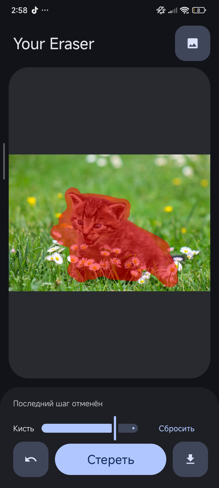
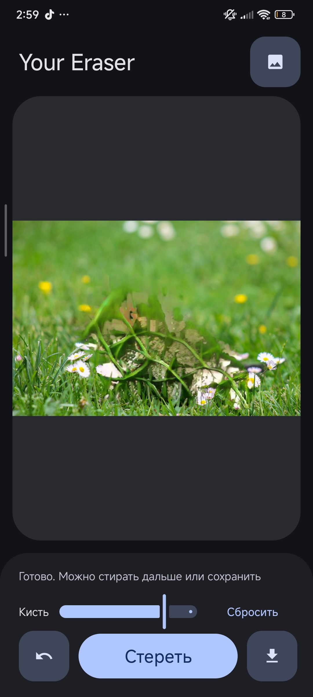

# Your Eraser

**Remove unwanted objects from photos, fully on-device.** Paint over what you want gone, tap *Erase*, and a small neural network fills in the background. Your photos never leave your phone.

> 🇷🇺 Краткое описание на русском — [ниже](#по-русски).




Image by **Ilona Ilyés** from **Pixabay**

## Features

- 🔒 **100% local.** Inference runs on the device with ONNX Runtime. No internet needed after install, no uploads, no accounts.
- 🖌️ **Simple brush workflow.** Paint, erase, undo (up to 5 steps), reset the mask, save.
- 🎨 **Material 3 look.** Dynamic color from your wallpaper, light and dark themes, large thumb-friendly controls at the bottom of the screen.
- 🖼️ **No storage permissions.** Photos are picked with the system photo picker and saved to `Pictures/YourEraser` through MediaStore.

## How it works

1. You pick a photo (downscaled to at most 2048 px on the long side).
2. The brush strokes become a binary mask (hole = pixels to remove).
3. The image and mask go to the [MI-GAN](https://github.com/Picsart-AI-Research/MI-GAN) inpainting network (ONNX pipeline) via [ONNX Runtime Mobile](https://onnxruntime.ai/).
4. The generated pixels replace only the masked area; the rest of the photo stays untouched.

## Download

Prebuilt APKs are published in [Releases](../../releases). Every successful build also stores the APK as an artifact on the Actions run page.

Installing requires allowing "install unknown apps" for your browser or file manager. The APK is debug-signed.

**Requirements:** Android 10 (API 29) or newer. About 100 MB of free space (the model is bundled).

## Build it yourself

You do not need a PC. The whole build runs in GitHub Actions:

1. Fork this repository.
2. Open **Actions → Build APK → Run workflow**.
3. When the run is green, grab `YourEraser.apk` from **Releases** (or the `YourEraser-apk` artifact at the bottom of the run page).

The workflow downloads the model at build time, so the model file is **not** stored in this repository.

### Repository layout

This project is generated at build time. That is unusual, so here is the map:

```
.github/workflows/
  build.yml        CI: sets up JDK and Gradle, runs gen.sh, downloads the model,
                   builds the APK, uploads the artifact, creates a release
  gen.sh           Generates the Gradle project (build files, manifest, resources)
  MainActivity.kt  UI, model loading, inference, saving
  PaintView.kt     Canvas view: image display, brush, mask
```

`gen.sh` creates a `proj/` directory with a standard Android Gradle project and copies the two Kotlin files into it. If you prefer a conventional layout, moving `proj/` contents into the repo root and deleting `gen.sh` is a welcome pull request.

### Tech stack

- Kotlin, plain Android views with [Material Components](https://github.com/material-components/material-components-android) 1.12
- [ONNX Runtime for Android](https://onnxruntime.ai/) 1.19
- Gradle 8.9, Android Gradle Plugin 8.5, compileSdk/targetSdk 34, minSdk 29

## Known limitations

- Quality drops on **large** objects: MI-GAN is a small, fast model. Erase big things in several passes, and use a slightly oversized brush.
- Best results: small objects, text, wires, blemishes, people on simple backgrounds.
- The first erase takes a few seconds while the model loads into memory.
- Photos larger than 2048 px are downscaled on import.
- Inference runs on CPU. GPU/NNAPI acceleration is not enabled yet.

## Roadmap ideas

- [ ] Optional heavier model (e.g. LaMa) for large areas
- [ ] One-tap object selection (a lightweight segmentation model)
- [ ] Brush-size preview and a mask eraser
- [ ] NNAPI / GPU execution provider
- [ ] Conventional Gradle project layout and release signing
- [ ] Localization (currently the UI is in Russian)

## Contributing

Issues and pull requests are welcome. Please open an issue first for larger changes. When reporting a bug, include your device model, Android version, and (if possible) a screenshot.

## Credits and licenses

- Inpainting model: **MI-GAN** by Picsart AI Research, ONNX export from [CardAnvilModels/MI-GAN-ONNX](https://huggingface.co/CardAnvilModels/MI-GAN-ONNX). The model is downloaded during the build and is subject to its own license. Check it before redistributing builds.
- [ONNX Runtime](https://github.com/microsoft/onnxruntime) (MIT) and [Material Components for Android](https://github.com/material-components/material-components-android) (Apache 2.0).

The source code of this repository is released under the license in [LICENSE](LICENSE).

---

## По-русски

**Your Eraser** убирает лишние объекты с фотографий прямо на телефоне. Закрасьте пальцем то, что нужно убрать, нажмите «Стереть», и нейросеть дорисует фон. Фото никуда не отправляются, интернет после установки не нужен.

**Как получить приложение:** скачайте `YourEraser.apk` из [Releases](../../releases) или соберите сами через GitHub Actions (форк → **Actions → Build APK → Run workflow**), ПК не нужен.

**Что важно знать:** лучше всего приложение убирает небольшие объекты, надписи и провода. Крупные объекты стирайте за несколько проходов. Требуется Android 10 или новее.
